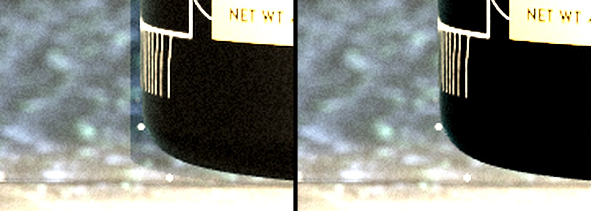

# What changed in the rework, and why

The first version of this scene was judged over-exposed, unpolished and less crisp than the vitamin E bottle. This records every change made in response, with the old value, the new value and the reasoning. Distances are in scene units (1 unit = 10 cm).

The method was to switch layers off one at a time (`?off=`, see the README) and look at each on its own, then to view the room in focus (`?blur=0`). Almost every fault traced back to one of three things: a layer that was too strong, a light with no real source, or a shortcut in how a layer was drawn.

## 1. The sleeve round the tub

**What it was.** A faint straight-edged box hugging the tub: a vertical edge a few pixels outside the tub's wall and a square corner where the real tub has a rounded heel.

**Cause.** The haze in the spotlight's beam was drawn after the tub, and stopped wherever the view ray met the tub. For speed, "the tub" in that test was a plain cylinder: radius 0.572 (the lid's), flat ends. The real body is narrower (0.555) with a heel rounded at radius 0.07. In the gap between the plain cylinder and the real tub, the haze was cut off although nothing was there, so the background showed through un-hazed, with the cylinder's exact outline.

**Fix** (`src/main.js`, `src/fx.js`). The haze is now drawn first, along the whole view ray, and the tub is drawn over it. The haze therefore meets the tub's real, anti-aliased outline. No haze is drawn in front of the tub any more, which also keeps the tub's blacks clean.

**Related fix** (`src/glsl.js`, `tubShade`). The tub's shadow inside the haze was an all-or-nothing test against the same cylinder, which gave the shadow hard edges. It is now a soft amount, fading over 0.35 units.

## 2. Exposure, glare and haze

| Setting | Before | After | Why |
| --- | --- | --- | --- |
| Spotlight strength (`KEY.candela`) | 30000 | 21000 | The label's whites and gold band were clipping towards white. |
| Haze in the beam (strength x `KEY.candela`) | 0.003 | 0.0009 | With the lower spotlight this is 21% of before. Seen alone, the haze was a brown cloud round the tub. |
| Haze texture | `(0.35 + 1.1n² + 0.5n·n2) x (1 + 0.5e^(-1.2y))`, noise scales 0.19 and 0.53 | `0.62 + 0.5n + 0.22n2`, scales 0.11 and 0.31 | The squared term made separate puffs. The new mix is an even haze with slow variation. |
| Glow round the strip light (x `TUBE.candela`) | 0.00004 | 0.000016 | It laid a veil over the whole frame and lifted the blacks. |
| Lens glow | 0.075 | 0.05 | Bright areas bled too far. |
| Wide sideways streak | (0.03, 0.036, 0.042) | (0.011, 0.013, 0.015) | Same. |
| Strip light tube brightness | 26 x v | 9 x v^1.6 | 26 only fed the lens glow. The power of 1.6 makes a failing tube look dim, so it does not look lit while the room is dark. |
| Strip light housing | 0.012 + 0.2v | 0.006 + 0.07v | It read as part of one white bar. |
| Cold edge light on the tub (`STRIP_ON_TUB`) | 6500 | 1700 | A broad white band that bloomed. |
| Background blur (`BLUR_AT_INFINITY`) | 11 / 1080 | 8 / 1080 | The gym was unreadable blobs. |

**Reflections must be dimmer than what they reflect** (`src/post.js`).

- The tub's streak on damp concrete was multiplied by 5.0, which made the reflection brighter than the label. It is now 1.1, and capped at 1.3.
- On damp concrete only the tub is reflected per frame. The strip light's sheen there is already in the baked images, so it was being counted twice.
- No per-frame glints on floor behind the tub. That floor is out of focus, but the glints were drawn pin-sharp, one per pixel. These were the "floating particles".
- In puddles, the strip light's mirror image was sharp while the strip light itself is far out of focus. It is now blurred by the same radius (12 samples) and scaled by 0.6 for dirty water.

## 3. The pool of light and the tub's shadow

**What it was.** A thin bright ring on the floor with a dark hole, and dark floor all round the tub's base.

**Causes and fixes.**

- **The beam was barely wider than the tub.** Radius where it reaches the tub: 1.5 outer and 0.98 inner, now 2.7 and 1.15 (`src/config.js`). The wide soft edge makes a pool that fades out instead of a ring.
- **Standing water lay inside the pool.** Open water is a mirror: under a spotlight it shows the dark room, not the light. The no-puddle zone was an ellipse of 1.25 x 1.1 round the tub; it is now 3.6 x 4.4, centred 2.6 units behind the tub (`src/floor.js`, `pools`). The small puddles under the drips stay.
- **The camera was too low to see the pool behind the tub.** From 0.72 units high, the pool's far edge appeared below the line of the tub's base, so no lit floor showed beside or behind the tub. A pool reaching R units behind the tub shows above that line when the camera height h > 0.24 (8.6 + R) / (0.57 + R): 1.17 for the old pool (R = 1.5), 0.75 for the new one (R = 3.2). The camera went from (0, 0.72, 8.6) looking at height 0.99 to (0, 1.1, 8.6) looking at height 1.02.
- **Lamp:** elevation 66° to 68°, azimuth 33° to 30°. Lamp size (`sourceRadius`) 1.3 to 3.0, for a softer shadow edge.
- **Shadow depth:** the darkest part of the shadow went from 6% to 14% of the lit floor, since haze scatters some light into it.
- **Floor colour:** base (0.07, 0.068, 0.064) to (0.06, 0.058, 0.054) with stronger mottling and speckle, so the lit concrete is not a flat pale band.

## 4. The equipment and the lights that reach it

**What it was.** The barbell plates nearest the camera were dark, with a warm brown tint that matched neither lamp.

**Causes and fixes** (`src/room.js`).

- **A light with no source.** A warm lamp of strength 60 sat under the floor to imitate the spotlight bouncing off the concrete. By my estimate the real bounce from that pool is about 2, roughly thirty times weaker. The lamp is removed.
- **The barbell stood in front of the strip light**, so the camera saw its unlit side. It moved from (-0.4, 2.25, -29.25) to (3, 2.25, -90), just beyond the strip light, which now lights the side we see and the floor round it.
- **Strip light moved** from anchor (3.4, 33, -64) to (3.4, 31, -78) so the whole fitting stays in frame with the higher camera.
- **Fill.** A faint all-round light (0.1) stands in for the strip light's light after it has bounced off the walls. It exists only in the strip light's baked images, so it flickers and dies with the strip light.
- **Two floor workarounds removed.** One faded out highlights on floor further than about 22 units from the camera, the other darkened the far floor. Both were added while hunting a bug that turned out to be elsewhere, and they were hiding the strip light's sheen on the floor beneath it.
- **Surfaces:** rubber roughness 0.72 to 0.55, red rubber 0.66 to 0.52, cast iron 0.58 to 0.45, and steel inserts round the holes of the rubber plates, so the plates take a visible highlight.
- **Kettlebell** moved from (-3.95, 0, -15.5) to (-4.7, 0, -21). It is still a dark foreground shape, lit only on its edge.
- **Windows** lowered (centre height 31.5 to 22.4), with the wall pipes moved below them, so they are in frame from the higher camera.

**The gap under the lid** (`src/tub.js`, `shadeCavities`). The cold edge light casts no shadow on the tub, so it lit the shoulder under the lid's lip: a bright sliver. The tub's occlusion strip now darkens direct light there as well as ambient light.

## 5. The chain and hook

**What it was.** An open ring (261° of a torus) placed below the chain without touching it, and the chain crossed in front of the strip light.

**Fix** (`src/room.js`, `hookChain`). A lifting hook built on the last link: an eye that passes through the link, a collar, a shank, and a bend of 234° with an upturned tip. It hangs at (-5, y, -47) beside the heavy bag, as the place a second bag used to hang, and no longer crosses the strip light.

## 6. Water and dust

| Setting | Before | After | Why |
| --- | --- | --- | --- |
| Splash droplets per impact | 9 | 7 | |
| Upward speed of droplets | 3 to 9 (jet 8.5) | 1.3 to 3.2 (jet 3.4) | Height is speed² / (2 x 46): the jet rose 0.79 units (8 cm), now 0.13 (about 1 cm). The old ones were the bright shards beside the tub. |
| Time droplets stay in the air | 0.42 s | 0.2 s | |
| Droplet brightness | 1.6 | 0.8 | |
| Falling drop: streak length | speed x 0.0095 each way | speed x 0.0042 | A long white needle read as a scratch. |
| Ring strength (puddle / damp) | 0.034 / 0.012 | 0.02 / 0.008 | The rings were hard black and white. |
| Dust motes | 900 | 520 | |
| Dust brightness (x `KEY.candela`) | 0.07 | 0.05 | |
| Puddle under the drip at (-1.65, -1.6) | 0.95 x 0.9 | 0.7 x 0.75 | It sits inside the pool of light. |

## 7. Motion

| Setting | Before | After |
| --- | --- | --- |
| Spin (`SPIN_SPEED`) | 1.0 rad/s, a turn in 6.3 s | 0.6 rad/s, a turn in 10.5 s |
| Bob (`BOB_SPEED`) | 2.0 rad/s | 1.5 rad/s |

## How it was checked

`npm test` runs `test/check.mjs` in headless Chrome. Results from the final build on an Apple M5:

- **Behaviour:** desktop (1440 px), phone (1170 px) and reduced-motion (700 px) views load with no console errors or warnings. Two resizes in quick succession end at the right size. Space pauses: two frames half a second apart are identical.
- **Lighting logic,** over 18 moments that include three failures of the strip light:

| Region | Result |
| --- | --- |
| Wall by the strip light | follows its brightness, correlation 0.995 |
| Barbell | follows it, correlation 0.998 |
| Wet floor beneath it | follows it, correlation 0.993 |
| Pool under the spotlight | steady: brightness moves by 0.015 on a 0 to 1 scale |
| Windows | steady: moves by 0.023 |
| Pixels clipped to white | 0.00% in every frame |

- **The sleeve** was checked by eye on brightened crops of the tub's edges, before and after, with the strip light on and off.

Not tested: a real phone, Safari, Firefox.
