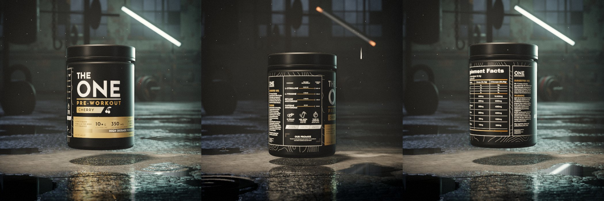

# The One Pre-Workout

A real-time product shot in the browser: the cherry tub of One Supplements' "The One" pre-workout, turning slowly and bobbing in an abandoned warehouse gym. One spotlight on the tub, a broken strip light flickering and swinging at the back, water dripping from the roof into puddles on the concrete.



Open `index.html` (double-click works once `bundle.js` is built).

- Space pauses.
- `?t=3` in the address shows a still at 3 seconds.
- `?res=1080` renders at exactly 1080 x 1080 (the default cap is 1440).
- `?calm` steadies the strip light and its swing. This is also what visitors get automatically when their system is set to reduce motion.

For checking the scene piece by piece:

- `?blur=0` shows the room in focus (the number is the background blur in pixels at 1080; the default is 8).
- `?off=` hides layers, comma-separated: `tub`, `beam` (haze in the spotlight), `dust`, `drips`, `strip` (the strip light and everything it lights), `steady` (the spotlight and the night outside), `air` (glow round the strip light), `refl` (moving reflections in the floor), `bloom`.

## How it works

The camera never moves, so the whole warehouse is rendered once at load into a few images, already blurred for depth of field:

- the room under its steady lights (the spotlight and the night outside the windows);
- the room under the strip light alone, at three positions of its swing.

Light adds up, so each frame the room is the first image plus the strip light's images, blended by where it has swung to and scaled by how bright it is at that instant. On top of that, each frame draws only what moves: the tub (twice, once for its reflection in the wet floor), its shadow, the strip light itself, the haze in the spotlight's beam, dust, and the drips with their splashes and rings.

The lighting follows two lamps and nothing else. The spotlight lights the tub, the pool on the floor and the dust in its beam. The strip light lights the wall, the equipment near it, the sheen on the wet floor, the cold edge on the tub and its own reflection in the puddles, and all of those flicker and go dark with it.

Everything is procedural. There are no image or model files: the label is drawn in code from the real artwork, and the only assets are three small font files (Josefin Sans and Roboto Condensed, both under the SIL Open Font License) that are built into `bundle.js`.

Built with [three.js](https://threejs.org/).

## Files

| File | What it holds |
| --- | --- |
| `src/config.js` | Camera, spotlight, strip light and drip positions: the place to retune the shot |
| `src/label.js` | The wrap-around label |
| `src/tub.js` | The tub's shape and materials |
| `src/room.js` | The warehouse: wall, windows, gym equipment, lamps |
| `src/floor.js` | Wet cracked concrete and its puddles |
| `src/fx.js` | Strip light flicker and swing, drips, dust, the beam |
| `src/post.js` | Compositing, depth of field, lens glow, film grain, colour grade |
| `src/main.js` | Baking at load and the per-frame loop |

## Run locally

```bash
npm install
npm run dev
```

Then open http://localhost:5220. `npm run build` writes the minified `bundle.js`.
